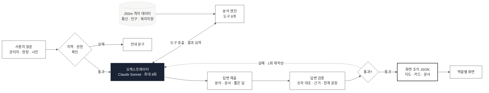
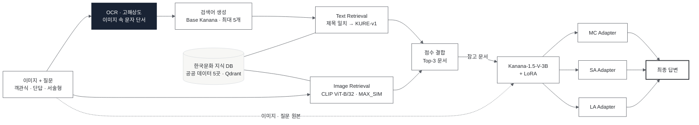
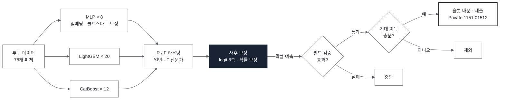
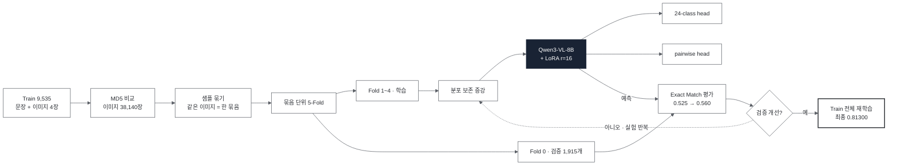

# 곽혜진 Portfolio

이미지와 텍스트를 함께 다루는 멀티모달 AI와 LLM 에이전트를 만들어 왔습니다. 모델이 낸 결과를 그대로 쓰기보다, 근거를 확인하고 검증하는 과정까지 함께 설계하는 것을 중요하게 생각합니다.

<table>
<tr><td><b>소속</b></td><td>숙명여자대학교</td></tr>
<tr><td><b>관심 분야</b></td><td>Vision-Language Model · Multimodal RAG · LLM Agent · 데이터 분석</td></tr>
<tr><td><b>GitHub</b></td><td><a href="https://github.com/Jinx921">github.com/Jinx921</a></td></tr>
</table>

 

## Highlights

- **HCLT 2026 포스터 (공동 제1저자 · 발표자)** — 「한국문화 멀티모달 질의응답을 위한 멀티모달 검색 증강 생성」
- **2026 빅콘테스트 1차 서류 합격** — 동네 돌봄 지도 (고립 위험 동네를 찾아 돌봄을 잇는 AI 에이전트), 2차 발표 2026.11.27
- **LG Aimers 9기 해커톤** — 최종 Private 1151.01512 · 상위 8% (1084.14 → 1151.02)
- **SNU AI Challenge** — Qwen3-VL-8B 기반 4프레임 시간순서 복원, 최종 리더보드 0.81300

 

## Projects

| # | 프로젝트 | 분야 | 기간 |
|---|---|---|---|
| 01 | [동네 돌봄 지도 - 고립 위험 AI 에이전트](#01) | LLM Agent · 공간 데이터 | 2026.09 – 진행 중 |
| 02 | [AIVQA: 한국문화 멀티모달 RAG VQA](#02) | VLM · Multimodal RAG | 2026.06 – 08 |
| 03 | [LG Aimers 9기: 투구 제구 성공 확률 예측](#03) | Tabular ML · 검증 설계 | 2026.07 – 09 |
| 04 | [SNU AI Challenge: 이미지 시간순서 복원](#04) | VLM · Image | 2026.07 |
| 05 | [청년 미래 선택 리스크 분석 RAG](#more) | RAG · LLM | 2026.05 – 06 |
| 06 | [folio.ai - Codex Hackathon](#more) | Frontend · AI 서비스 | 2026.08 |
| 07 | [따릉이 고장 주기 예측](#more) | 시계열 · 공간 군집 · 대시보드 | 2026.03 – 05 |
| 08 | [청년 미래 설계 멀티 에이전트](#more) | RAG · Multi-Agent | 2026.01 – 02 |
| 09 | [Onboarding - 학습 관리 서비스](#more) | Frontend | 2024.12 – 2025.02 |
| 10 | [플랜토리 - 성장형 일기 앱](#more) | Product Design · App Store 출시 | 2025.05 – 2026.01 |

---

### 01. 동네 돌봄 지도 - 고립 위험 동네를 찾는 검증형 AI 에이전트

> 2026 빅콘테스트 데이터활용분야 · 4명 · **AI 에이전트 개발**, 데이터 분석, 외부 데이터 수집

**문제** 고립 대응은 민원 · 신고 이후에야 시작되고, 인력이 부족해 전수 방문이 불가능합니다. 개인 명단으로 고르면 낙인과 개인정보 문제가 생깁니다. 여기에 LLM을 붙이면 계산하지 않은 숫자를 그럴듯하게 지어낼 위험도 있었습니다.

**해결** 통신 유동인구 · 인구 · 복지자원 데이터를 250m 격자로 묶어 규칙 기반 분석 엔진이 위험 후보를 계산하고, 저는 그 위에서 질문을 해석해 엔진 도구를 호출하는 Claude 기반 에이전트를 만들었습니다. 답변마다 **숫자 대조 · 근거 필수 · 한계 문장** 검증을 거쳐, 통과하지 못하면 고칠 점을 돌려주어 다시 쓰게 하거나 표시를 막았습니다. 시민 화면에서는 위험 · 고립 표현 자체를 검증에서 차단했습니다.

**결과** 춘천 7,393칸을 먼저 방문할 55칸으로(범위 99.3% 축소), 강남 698칸을 13칸으로 좁혔습니다. 6개월 내내 위축된 칸은 무작위 대비 7~10배 많아 우연이 아님을 확인했습니다. 에이전트는 테스트 186개로 검증했고, 서비스를 배포해 1차 서류를 통과했습니다.

[상세 문서](projects/01-social-isolation-agent.md) · [코드](https://github.com/Jinx921/26-2_BITAminB5) · [서비스](https://bigcontest-production.up.railway.app)

---

### 02. AIVQA - 한국문화 멀티모달 RAG

> 2026년 인공지능(AI)말평 경진대회 · BITAmin CV팀 · 4명 · HCLT 2026 포스터 공동 제1저자 · **OCR · 이미지 해상도 연구**, 멀티모달 RAG DB

**문제** 한국문화 질문은 이미지만 봐서는 풀 수 없습니다. 문화재 · 유물 · 전통문화의 고유명사와 배경지식이 필요한데, 3B 소형 모델은 내부 지식이 부족했습니다. 대상의 이름이 질문에 없고 이미지 속 글자나 외형으로만 알 수 있는 경우도 많았습니다.

**해결** 저는 이미지 속 글자를 읽는 **OCR · 해상도 문제**를 맡아, OCR이 필요한 문항에만 해상도를 올리는 방식으로 단답 정답률을 15.4% → 21.2%로 올렸습니다. 그 과정에서 "글자를 읽어도 이름을 모르면 못 맞힌다"는 병목을 확인해 외부 지식 검색으로 방향을 잡았고, 한국관광공사 데이터로 멀티모달 RAG DB를 만들었습니다. 최종 시스템은 공공 데이터 5곳의 지식 DB에서 질문 · **이미지 속 문자 정보**로 찾는 Text Retrieval과 외형으로 찾는 Image Retrieval을 결합해 Kanana-V 3B에 넣었습니다.

**결과** Multimodal RAG로 종합 점수 43.14 → **47.07** (+3.93), 텍스트 RAG만 쓸 때(45.11)보다 +1.96 올라 한국문화를 사전학습한 33B EXAONE(46.99)을 넘었고, 증강 데이터 500개를 더해 **47.40**까지 올렸습니다. HCLT 2026에 공동 제1저자로 논문을 내고 포스터 발표를 맡았습니다.

[상세 문서](projects/02-aivqa.md) · [코드](https://github.com/Jinx921/CV_korea) · [팀 저장소](https://github.com/kjh0902/AIVQA)

---

### 03. LG Aimers 9기 - 투구 제구 성공 확률 예측

> LG Aimers 9기 해커톤 · 4명 · **사후 보정 · 제출 판정 기준**, 검증 도구

**문제** 제출 횟수가 한정된 대회에서 어떤 변경을 제출할지 정해야 했습니다. 매 시즌 처음 보는 투수가 14~22%였는데, 이들이 학습되지 않은 임베딩 한 칸을 함께 쓰고 있었습니다.

**해결** 처음 보는 투수의 임베딩을 학습된 임베딩 평균으로 채우는 콜드스타트 보정을 넣고, 로짓 공간 사후 보정층을 맡았습니다. 제출 전 8개 항목을 한 명령으로 확인하는 검증 도구를 만들고, 성공 확률이 아니라 기대 이득 기준으로 제출 순서를 정하도록 판정 기준을 고쳤습니다.

**결과** 리더보드 점수를 1084.14 → 1151.02 (+66.87)로 올려, 최종 Private **1151.01512 · 상위 8%** 를 기록했습니다.

[상세 문서](projects/03-lg-aimers.md) · [코드 (hyejin 브랜치)](https://github.com/26-BITAmin/LG_aimers_9th/tree/hyejin)

---

### 04. SNU AI Challenge - 이미지 시간순서 복원

> SNU AI Challenge · 4명 · **데이터 분할 설계 · VLM 학습** 전 과정

**문제** 스토리 문장과 순서가 섞인 이미지 4장을 받아 원래 시간 순서를 맞히는 과제였고, 네 자리를 모두 맞혀야 점수가 나는 Exact Match로 평가했습니다. 같은 이미지가 여러 샘플에 반복돼 검증 점수가 부풀 위험이 있었습니다.

**해결** 이미지 MD5로 중복을 묶어 같은 묶음이 다른 fold로 갈라지지 않게 분할하고, 팀 공통 fold 파일을 checksum과 함께 배포했습니다. Qwen2-VL-2B → Qwen2.5-VL-7B → Qwen3-VL-8B로 키우며 LoRA를 학습했고, 문장 생성 대신 24개 순열을 직접 고르는 분류 head와 이미지 쌍의 선후를 맞히는 pairwise loss를 더했습니다.

**결과** 최종 리더보드 **0.81300**을 기록했습니다. 내부 검증(Fold 0, 1,915개)에서는 분류 head와 pairwise loss로 Exact Match를 0.525 → 0.560까지 올렸고, 이 레시피로 Train 전체를 학습해 제출했습니다.

[상세 문서](projects/04-snu-ai-challenge.md) · [코드 (hyejin 브랜치)](https://github.com/26-BITAmin/SNU_AI_Challenge/tree/hyejin)

 

## More Projects

| # | 프로젝트 | 내용 | 역할 · 결과 | 링크 |
|---|---|---|---|---|
| 05 | **청년 미래 선택 리스크 분석 RAG**  2026.05 – 06 · 개인 | KOSIS 통계를 리스크 판단용 Evidence Card로 재구성해 FAISS로 검색하고, 선택지별 리스크 5개 항목 점수와 대응 전략, PDF 리포트 생성 | 기획 · 구현 전체 | [문서](projects/05-youth-risk-rag.md) · [코드](https://github.com/Jinx921/26-1_AI_project) |
| 06 | **folio.ai**  2026.08 · Codex Hackathon 12팀 | GitHub 저장소를 분석해 개발자 포트폴리오와 이력서 초안을 만드는 AI 서비스 | 프론트엔드 (Next.js · React · TypeScript) | [문서](projects/06-folio-ai.md) · [코드](https://github.com/codex-hackathon-12/team12) · [시연](https://youtu.be/08R_W-f0S8Q) |
| 07 | **따릉이 고장 주기 예측**  2026.03 – 05 · BITAmin 시계열팀 (3명) · 서울시 빅데이터 활용 경진대회 출품 | 고장 · 대여 · 위치 · 날씨 데이터로 고장 위험 자전거 · 부품 · 대여소를 예측하는 정비 대시보드 | 고장 핫스팟 분석 (DuckDB ASOF JOIN 위치 추정, K-Means), 대여소 30일 예측 MAE 146.8 → 74.0, Streamlit 통합 · 디자인 | [문서](projects/07-ttareungyi.md) · [코드](https://github.com/Jinx921/26-1_BITAmin_project) · [대시보드](https://ts-project-dashboard.streamlit.app/) |
| 08 | **청년 미래 설계 멀티 에이전트**  2026.01 – 02 · BITAmin NLP팀 (4명) | 소득 · 자산 · 계획을 받아 주거 정책과 금융 상품을 엮은 미래 설계 의견서를 만드는 멀티 에이전트 | 주거 에이전트: 정책 데이터 정규화 · 청킹 · FAISS retriever · 의견서 프롬프트 | [문서](projects/08-youth-housing-agent.md) · [코드](https://github.com/26-1-BITAmin-NLP/NLP) |
| 09 | **Onboarding**  2024.12 – 2025.02 · UMC 7기 TeamLearningFlow | 학습 목표 설정과 진행 관리를 돕는 학습 관리 웹 서비스 | 프론트엔드 (팀 내 최다 커밋 139개, 이슈 22개 완료): 로그인 · 회원가입 · 랜딩 · 홈 · 검색 · 마이페이지, 반응형 | [문서](projects/09-onboarding.md) · [코드](https://github.com/TeamLearningFlow/Onboarding-FE) |
| 10 | **플랜토리**  2025.05 – 2026.01 · UMC 8기 · App Store 출시 | 일기를 쓰면 식물이 자라는 성장형 감정 일기 iOS 앱 | 프로덕트 디자이너 (2명): 온보딩 · 일기 확인 · AI 채팅 · 마이/통계 · 프로필 화면, 디자인 시스템 · 아이콘 공동 | [문서](projects/10-plantory.md) · [App Store](https://apps.apple.com/kr/app/%ED%94%8C%EB%9E%9C%ED%86%A0%EB%A6%AC-plantory/id6757394785) |

 

## Activities

| 기간 | 활동 | 내용 |
|---|---|---|
| 2022.04 – 06 | **SWTC 교육기부** · 강사 | 6주간 스크래치 코딩 수업 진행 (좌표 · 반복문 · 난수 등 기초 개념과 게임 제작 실습) · 팀 우수상 |
| 2024.09 – 2025.02 | **UMC 7기** · Web 파트 | Onboarding (09) · 데모데이 참가 · 서비스 인스타그램 운영 · 수료증 |
| 2025.03 – 08 | **UMC 8기** · Web 파트장 · Design 파트 | Web 파트장 활동으로 **공로상** 수상 · 플랜토리 디자인 (10) · 데모데이 참가 · 수료증 |
| 2025.12 – 현재 | **BITAmin** 빅데이터 분석 및 인공지능 동아리 | NLP · 시계열 · CV · 데이터 분석 프로젝트 (08 · 07 · 02 · 01), 대회 팀 활동 (03 · 04) |
| 2026.01 – 현재 | **CV 논문 리뷰 스터디** | 매주 한 편씩 리뷰 — 인식(ViT · Swin · Grounding DINO · YOLO-World · SAM), 멀티모달(BLIP-2 · LLaVA), 생성(VAE · GAN · DDPM · DDIM · LDM · DiT), 3D(NeRF · 3D Gaussian Splatting · DUSt3R) 등 24주 이상. 발표 4회 (Diffusion · BLIP-2 · SAM · GAN) |

 

## Competitions

| 기간 | 대회 | 내용 |
|---|---|---|
| 2026.03 – 05 | **2026 서울시 빅데이터 활용 경진대회** | 따릉이 고장 예측 · 정비 대시보드 (07) |
| 2026.05 | **믹스업 데이터톤** | SMILES 분자 구조로 hERG 독성(심장 이온 채널 저해)을 예측하는 회귀 과제. RDKit descriptor · Morgan fingerprint · ChemBERTa 피처를 view별 GBDT로 학습해 앙상블 |
| 2026.06 – 08 | **2026년 인공지능(AI)말평 경진대회** · 한국문화 멀티모달 질의응답 | 한국문화 VQA, Kanana 3B + 멀티모달 RAG로 33B 모델 상회 · HCLT 2026 poster accept (02) |
| 2026.07 | **SNU AI Challenge** | 문장에 맞게 이미지 4장의 시간순서 복원, Qwen3-VL-8B · 최종 0.81300 (04) |
| 2026.07 – 08 | **데이콘 풍력 발전량 예측** | 풍력 발전량 시계열 예측 |
| 2026.07 – 09 | **LG Aimers 9기** | AI 교육 수료 후 Phase 2 해커톤, 투구 제구 성공 확률 예측 · 상위 8% (03) |
| 2026.08 | **Codex Hackathon** | Codex Community Korea · PseudoLab · BITAmin · ToBig's 공동 주최 1일 해커톤, folio.ai 프론트엔드 (06) |
| 2026.09 – 진행 중 | **2026 빅콘테스트** 데이터활용분야 | 동네 돌봄 지도 — 고립 위험 동네를 찾는 AI 에이전트 (01) · **1차 서류 합격 · 2차 발표 2026.11.27** |

 

## Technical Skills

| 분야 | 기술 |
|---|---|
| **Languages** | Python, TypeScript |
| **Vision-Language / DL** | PyTorch, Hugging Face Transformers · PEFT(LoRA), Qwen-VL · Kanana-V · InternVL, CLIP, PaddleOCR |
| **RAG · LLM** | Qdrant, FAISS, Claude API (tool use), OpenAI API, 프롬프트 설계 · 답변 검증 |
| **Tabular · Time Series** | LightGBM, CatBoost, XGBoost, scikit-learn, Prophet, pandas |
| **Service** | Streamlit, Next.js, React |
| **Design** | Figma |
