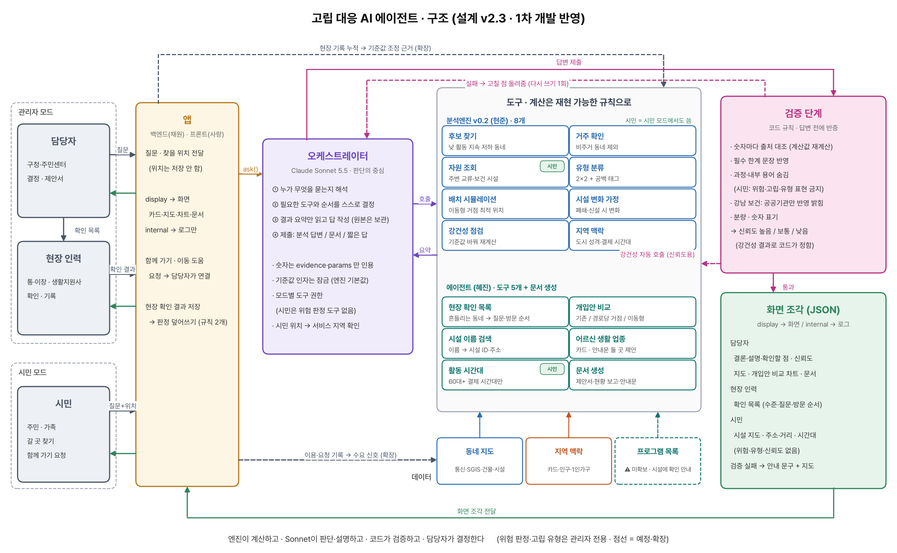
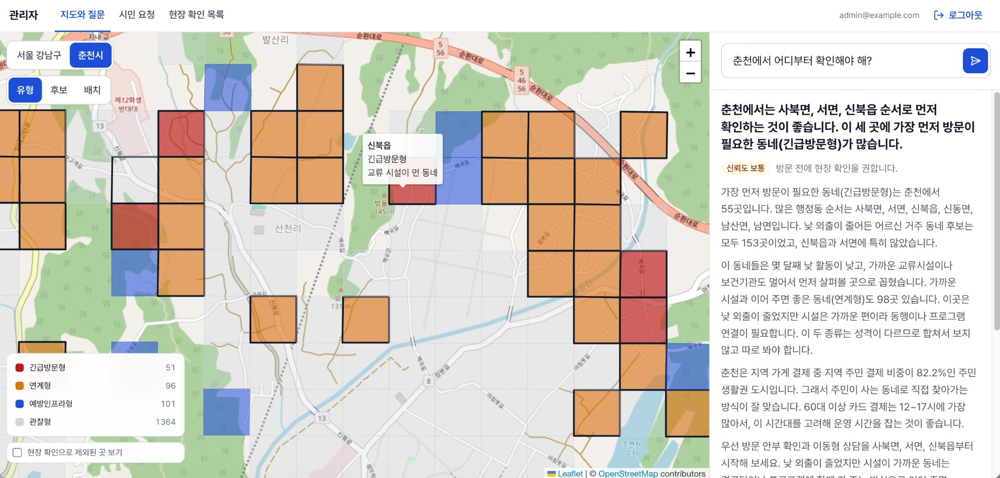
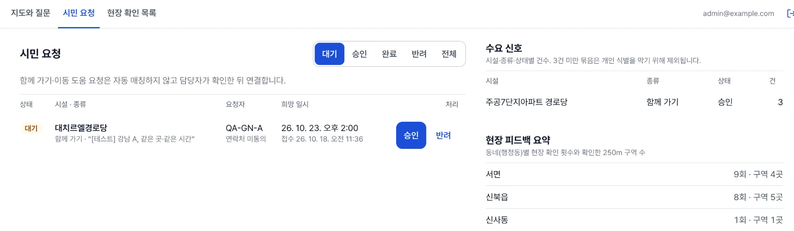
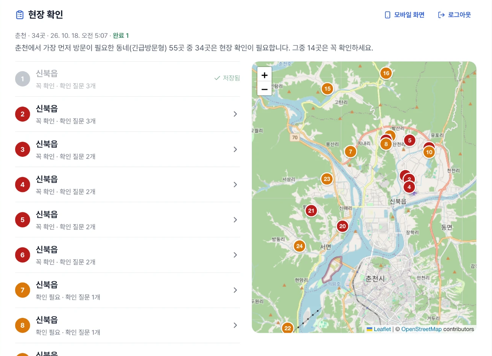
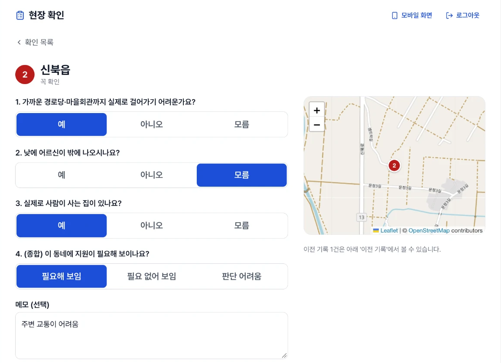
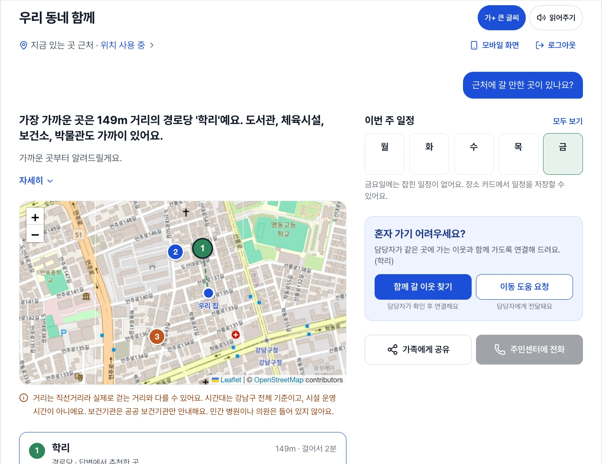
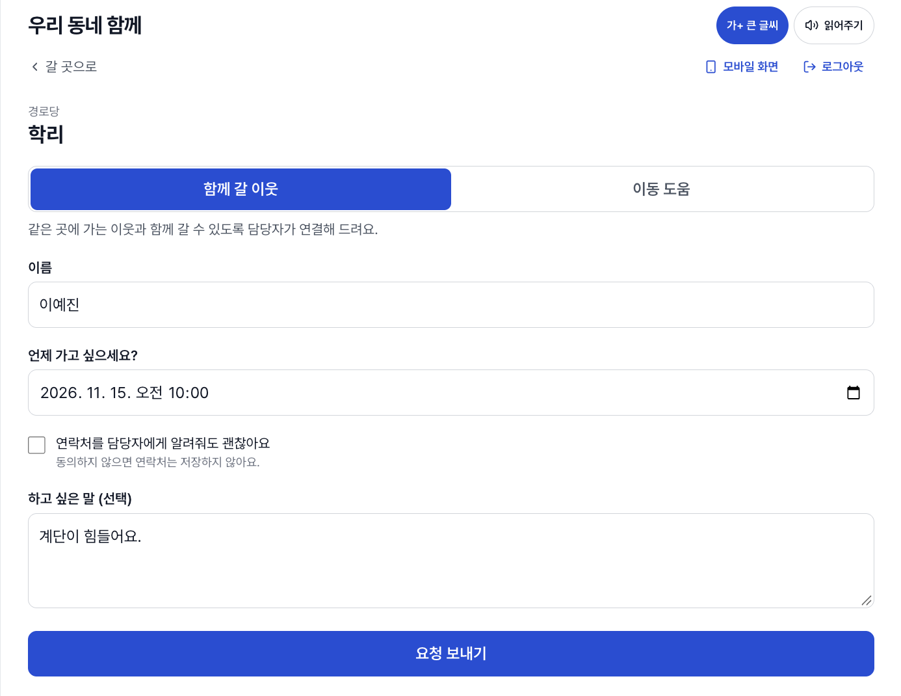

# 01. 동네 돌봄 지도 - 고립 위험 동네를 찾아 돌봄을 잇는 AI 에이전트

> **소속** 2026 빅콘테스트 데이터활용분야 · 4명 
> **역할** 데이터 분석 · 외부 데이터 수집 · AI 에이전트 개발 
> **기간** 2026.09 – 진행 중 · 1차 서류 합격, 2차 발표 2026.11.27

**Links** [코드](https://github.com/Jinx921/26-2_BITAminB5) · [서비스](https://bigcontest-production.up.railway.app) · [에이전트 문서](https://github.com/Jinx921/26-2_BITAminB5/blob/main/agent/README.md)

 

## Overview

통신 · 인구 · 복지자원 데이터를 250m 동네 단위로 읽어, **설명 가능한 규칙으로 방문 우선순위를 제안하는 AI 에이전트**입니다. 개인이 아니라 동네를 판단 단위로 삼아 낙인 없이 **먼저 확인할 곳**을 좁히고, 최종 결정은 담당자가 합니다. 저는 질문을 해석해 분석 엔진을 호출하고, 답변을 검증해 화면에 보낼 형태로 바꾸는 **AI 에이전트 층**을 맡았습니다.

| 핵심 수치           |                                                           |
| ------------------- | --------------------------------------------------------- |
| 방문 범위 압축      | 춘천 7,393칸 → 55칸 (99.3%↓) · 강남 698칸 → 13칸 (98.1%↓) |
| 우연 대비 반복 위축 | 6개월 내내 위축된 칸이 무작위 1,000회 평균의 7~10배       |
| 테스트              | 에이전트 186개 · 엔진 19개                                |

## Problem

- **기존 대응의 한계** 민원 · 신고 이후에야 개입하고, 인력 한계로 전수 방문이 불가능하며, 개인 명단 기반 선별은 낙인과 개인정보 부담이 있습니다.
- **단순 지표로는 부족** "1인 가구가 많다", "고령층이 많다" 하나만으로는 위험을 판단할 수 없습니다. 활동 변화와 지원 접근성을 함께 봐야 합니다.
- **정답 데이터 없음** 고립 여부 라벨이 없어 지도학습 대신 설명 가능한 규칙과 우연 비교로 검증해야 했습니다.
- **LLM 위험** 모델이 계산하지 않은 숫자를 지어내거나, 시민에게 위험 판정을 노출할 수 있습니다.

## Approach

**분석 엔진** 거주 칸 → 고령 비율 상위 25% + 비슷한 동네(KMeans 8개 묶음) 대비 낮 활동이 낮은 달(robust z < 0)이 6개월 중 4개월 이상 → 경로당 500m · 보건기관 3km 밖 순으로 좁혀 4유형(긴급방문 · 연계 · 예방인프라 · 관찰)으로 분류합니다.

**AI 에이전트**

1. **역할 분리** AI는 질문 해석 · 도구 선택 · 설명만 맡고, 숫자 계산은 엔진만 합니다. 도구 호출 때 기준값 인자를 제거해 AI가 판정 기준을 바꾸지 못하게 했습니다.
2. **도구 호출 반복** Claude Sonnet이 엔진 도구(후보 탐지 · 유형 분류 · 배치 · 강건성 등 8개)를 고르면, 권한 확인 → 엔진 실행 → 원본 보관 → 요약만 전달을 반복합니다. 호출은 질문당 최대 8회로 제한했습니다.
3. **답변 신뢰 장치 4단계**
   - **숫자 대조** 출처 없는 숫자, 엔진과 다른 값 차단
   - **근거 필수** 도구 결과 없이 지역을 판단하면 차단
   - **한계 문장** 사용한 도구에 맞는 한계 문장이 없으면 차단
   - **다시 쓰기** 실패하면 고칠 점을 전달해 1회 재작성, 또 실패하면 안내만 표시
4. **신뢰도 등급** 기준을 하나씩 바꿔도 판정이 70% 이상 유지되면 "높음". 등급은 코드가 계산하고 AI가 고르지 않습니다.
5. **낙인 방지** 시민 모드에서는 위험 판정 도구를 쓸 수 없고, 위험 · 고립 · 유형 표현을 검증에서 차단합니다.
6. **현장 확인 목록** 기준값을 ±20% 바꾼 54개 조합으로 다시 판정해, 80% 이상 유지되면 제외하고 50% 미만이면 "꼭 확인"으로 안내합니다.

## Architecture

## Screens

### 관리자

어디부터 확인할지 물으면 고립 위험 유형 지도와 신뢰도 등급, 근거가 붙은 답변을 함께 보여 줍니다.

시민의 함께 가기 · 이동 도움 요청을 담당자가 확인해 승인하고, 현장 확인 결과를 동네별로 모아 봅니다.

### 현장 담당자

<table>
<tr><th width="50%">확인 목록</th><th width="50%">동네별 확인</th></tr>
<tr><td valign="top"></td><td valign="top"></td></tr>
</table>

기준을 바꿔도 판정이 흔들리는 동네부터 방문 순서를 정하고, 동네마다 확인 질문에 답해 결과를 저장합니다.

### 시민

<table>
<tr><th width="50%">갈 곳 안내</th><th width="50%">함께 가기 요청</th></tr>
<tr><td valign="top"></td><td valign="top"></td></tr>
</table>

위험 판정 없이 가까운 시설과 다니기 좋은 시간을 안내하고, 혼자 가기 어려우면 함께 갈 이웃이나 이동 도움을 요청할 수 있습니다. 연락처는 동의한 경우에만 저장합니다.

## My Contribution

- 에이전트 오케스트레이터 — 도구 호출 반복, 재작성 1회, 프롬프트 캐시, API 오류 · 시간 초과 시 안내 문구 대체
- 답변 검증 4단계와 시민 화면 낙인 방지 규칙
- 에이전트 도구 — 현장 확인 목록(54개 조합 재판정), 개입안 비교, 시민 시간대 · 시설 검색
- 엔진 · 백엔드 · 프론트 연결 규격 (화면 조각 JSON)
- 에이전트 테스트 186개 (API 키 없이 동작하는 `FixtureEngine`)
- 외부 데이터 수집 · EDA — 사회복지시설 · 도서관 · 공공체육 · 문화시설 등 사회적 기회 자원

## Result

| 사용자      | 질문 예                                    | 결과                                                      |
| ----------- | ------------------------------------------ | --------------------------------------------------------- |
| 관리자      | 춘천에서 어디부터 확인해야 해?             | 유형 지도 + 신뢰도 등급                                   |
| 관리자      | 이동형이랑 경로당 거점 중 뭐가 나아?       | 해소되는 동네 수로 비교 (춘천은 이동형 우세, 강남은 동일) |
| 관리자      | 사업 제안서 / 현황 보고 / 주민 안내문 써줘 | 문서 초안                                                 |
| 현장 담당자 | 현장 확인 목록 만들어 줘                   | 긴급방문형 55곳 중 확인 필요 34곳, 그중 "꼭 확인" 14곳    |
| 시민        | 근처에 다니실 만한 곳 있어요?              | 위험 표현 없이 가까운 시설과 다니기 좋은 시간             |

- 이동형 서비스 배치 시 긴급방문형 55곳 중 16곳 해소, 경로당 거점은 9곳

### 한계와 다음 단계

- **한계** 통신 데이터가 6개월치뿐이라 전년 · 계절 비교가 불가능하고, 후보는 기준값(특히 주택 수)에 따라 달라질 수 있습니다. 후보는 확정이 아니라 현장 확인 대상입니다.
- **다음 단계** 현장 확인 결과(거주자 없음 → 제외, 지원 불필요 → 관찰형)를 기준 보완에 반영하는 순환 구조를 운영합니다.

 

[← 포트폴리오로 돌아가기](../README.md)
