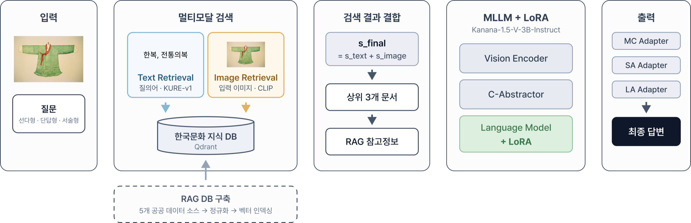
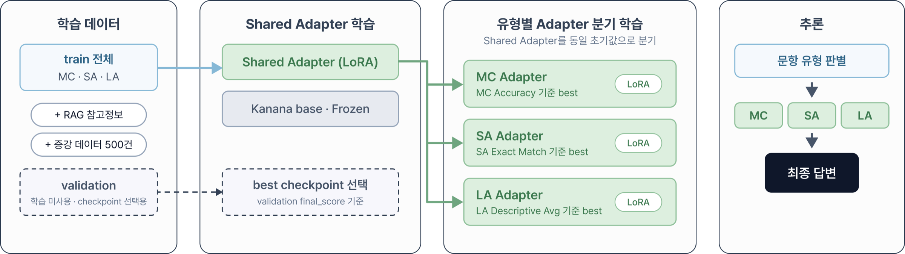
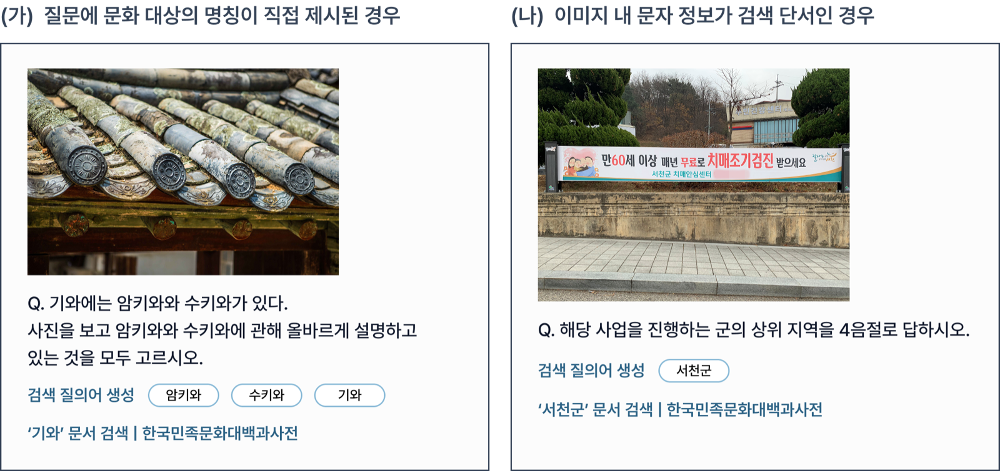
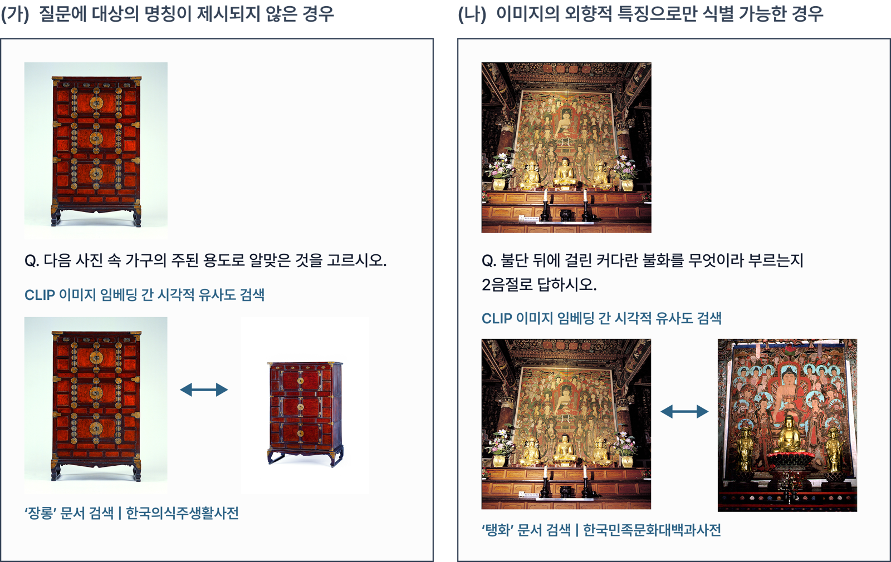

# 02. AIVQA - 한국문화 멀티모달 질의응답을 위한 멀티모달 RAG

> **소속** 2026년 인공지능(AI)말평 경진대회 · 팀 4명 
> **역할** OCR · 이미지 해상도 연구, 외부 데이터 멀티모달 RAG DB, 논문 Figure · HCLT 발표 
> **기간** 2026.06 – 08

**Publication** 김준형†, **곽혜진†◦**, 이신영†, 이정빈†. 「한국문화 멀티모달 질의응답을 위한 멀티모달 검색 증강 생성」, *2026년도 한글 및 한국어 정보처리 학술대회 (HCLT 2026)*, Poster. († 공동 제1저자, ◦ 발표자)

**Links** [대회 페이지](https://kli.korean.go.kr/benchmark/taskOrdtm/taskList.do?taskOrdtmId=211) · [코드](https://github.com/Jinx921/CV_korea) · [팀 저장소](https://github.com/kjh0902/AIVQA)

 

## Overview

이미지와 한국어 질문을 받아 문항 유형에 맞는 답을 만드는 한국문화 멀티모달 질의응답 시스템입니다. 연구 질문은 **"소형 MLLM의 부족한 내부 지식을 외부 지식 검색으로 보완할 수 있는가?"** 였습니다. Kanana-1.5-V-3B에 텍스트 · 이미지 두 경로의 한국문화 지식 검색을 붙여, 한국문화를 사전학습한 EXAONE-4.5-33B와 겨룰 수 있는지 검증했습니다.

| 핵심 수치 (AI말평 공식 평가, test 800문항) | |
|---|---|
| Multimodal RAG 적용 | 43.14 → **47.07** (+3.93) |
| Text RAG만 적용했을 때 대비 | +1.96 (45.11 → 47.07) |
| EXAONE-4.5-33B (LoRA) | 46.99 — 3B 모델이 소폭 상회 |
| + 증강 데이터 500개 | **47.40** |
| 조건부 고해상도 입력 | SA Exact Match 15.4% → 21.2% |

## Problem

- **과제** 국립국어원 AI말평 한국문화 멀티모달 QA. train 1,000 · validation 200 · test 800, 객관식(MC) · 단답(SA) · 서술형(LA) 세 유형
- **EDA에서 찾은 병목 세 가지**
  1. **고유명사 지식 부족** — OCR보다 이미지 속 사물 · 장소 · 기관의 이름을 아는지가 더 큰 병목, 정답이 데이터셋 전체에서 거의 유일해 시각 인식만으로는 풀 수 없음
  2. **음절 · 어절 수 제약 미준수** — 프롬프트에 명시해도 위반율 50% 이상
  3. **해상도와 글자 인식의 트레이드오프** — 패치 수 제한 때문에 resizing을 하면 작은 글씨 인식률이 떨어짐
- **모델 규모** 같은 학습 조건에서 EXAONE 33B가 Kanana 3B보다 종합 3.85점 높았습니다.

## Approach

1. **베이스라인 분담 비교** 팀원별로 VLM을 하나씩 맡아 같은 LoRA 조건으로 비교했습니다. 저는 InternVL3.5-8B를 맡았고, 초기에는 Qwen3-VL이 가장 좋아 Qwen으로 통일해 실험하다가 이후 Kanana-1.5-V-3B로 베이스를 바꿨습니다.
2. **OCR · 해상도 연구** 이미지 속 작은 글씨를 읽기 위해 PaddleOCR(PP-OCRv5) 텍스트 주입과 영역 crop을 실험하고, OCR이 필요한 문항에만 해상도를 올리는 조건부 고해상도 입력으로 SA Exact Match를 15.4% → 21.2%로 올렸습니다. 이 과정에서 "글자를 읽어도 이름을 모르면 못 맞힌다"는 병목을 확인했고, 이것이 외부 지식 검색(RAG)으로 방향을 잡는 근거가 됐습니다.
3. **외부 데이터 멀티모달 RAG DB** 한국관광공사 TourAPI의 이미지 · 텍스트를 수집해 멀티모달 RAG DB를 구축하고, 이미지-텍스트 유사도로 문서와 이미지를 매핑하는 파이프라인을 만들었습니다.
4. **최종 지식 DB · 검색** 한국민족문화대백과사전 · 한국민속대백과사전 · e뮤지엄 · 국가유산포털 · 법제처 5개 공공 데이터를 공통 스키마로 정규화해 Qdrant에 저장했습니다. Text Retrieval은 Base Kanana가 만든 질의어(최대 5개)를 제목 정확 일치 → KURE-v1 유사도(≥ 0.9)로 찾고, Image Retrieval은 CLIP ViT-B/32 멀티벡터의 최대 유사도(≥ 0.9)로 찾습니다. 두 점수를 더해 상위 3개 문서를 참고 정보로 넣습니다.
5. **학습** 검색 결과를 정답이 아닌 참고 정보로 주고(soft reference), 같은 RAG 문맥으로 LoRA를 학습했습니다. Shared Adapter → MC · SA · LA 유형별 Adapter로 나눴습니다.

## Architecture

논문 그림 1 - 텍스트 · 이미지 두 경로로 지식을 검색하고, 점수를 합친 상위 3개 문서를 Kanana의 답변 생성에 씁니다.

논문 그림 2 - 공통 Shared Adapter를 먼저 학습한 뒤 같은 지점에서 문항 유형별 Adapter로 나눕니다.

## My Contribution

- **OCR 향상 · 이미지 해상도 문제 연구** — PaddleOCR crop · PP-OCRv5 비교, 조건부 고해상도 입력 (SA EM 15.4% → 21.2%)
- **VLM 베이스라인** — 데이터 EDA, InternVL3.5-8B LoRA 베이스라인 담당, Qwen3-VL 통일 이후 실험
- **외부 데이터 멀티모달 RAG** — 한국관광공사 TourAPI 이미지 · 텍스트 수집(727건 선정), 이미지 RAG DB 구축, 이미지-텍스트 매핑 파이프라인
- **논문** — Figure 제작, 공동 집필 · 피드백 (공동 제1저자)
- **HCLT 2026 포스터 발표**

## Result

| 구분 | 모델 | 종합 | MC Acc | SA EM | LA Desc Avg |
|---|---|---:|---:|---:|---:|
| 모델 비교 | Kanana 3B | 43.14 | 72.77 | 27.67 | 28.99 |
| | EXAONE 33B | 46.99 | 75.90 | 31.55 | 33.52 |
| 검색 방식 | Kanana + Text RAG | 45.11 | 72.29 | 28.64 | 34.39 |
| | **Kanana + Multimodal RAG** | **47.07** | 72.29 | **32.52** | 36.39 |
| 데이터 증강 | + Data Aug (500개) | **47.40** | 73.25 | 31.07 | **37.88** |

- Multimodal RAG는 단답 Exact Match를 +4.85%p, 서술형 점수를 +7.40 올렸습니다. 지식이 필요한 문항일수록 효과가 컸습니다.
- **이미지 속 글자가 검색 단서가 된 사례** — 이미지의 "서천군"을 질의어로 문서를 찾아 상위 행정구역(충청남도)을 맞혔습니다.
- **외형으로 찾은 사례** — 이름이 없는 가구 이미지에서 장롱 문서를, 불단 뒤 그림에서 불교 회화 문서를 찾았습니다.

### 한계와 다음 단계

- **한계** 음절 · 어절 수 제약은 프롬프트로 해결되지 않았습니다. 증강 데이터는 단답이 좁은 범주에 치우쳐 SA가 1.45%p 떨어졌습니다.
- **다음 단계** 제약 디코딩으로 형식 위반을 해결하고, 검색 품질이 낮을 때 추가 검색 · 보정(Corrective RAG 계열)을 적용합니다.

 

[← 포트폴리오로 돌아가기](../README.md)
