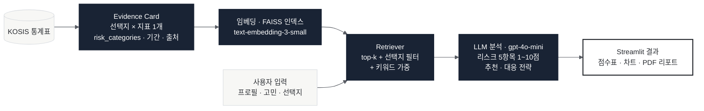

# 05. 청년 미래 선택 리스크 분석 시스템

> **소속** 생성형AI의이해 수업 · 개인 프로젝트 
> **역할** 기획 · 구현 전체 
> **기간** 2026.05 – 06

**Links** [코드](https://github.com/Jinx921/26-1_AI_project)

 

## Overview

진로 선택지(예: 대기업 vs 스타트업, 취업 vs 대학원)를 입력하면 KOSIS 통계 근거를 검색해 선택지별 리스크 점수와 대응 전략을 만들고, 점수표 · 차트 · PDF 리포트로 보여 주는 의사결정 지원 시스템입니다.

## Problem

- GPT에게 진로 상담을 그대로 물으면 근거 없는 일반론이 나옵니다.
- KOSIS 원본 표를 그대로 임베딩하면 사용자 질문과 "리스크 판단"이 직접 연결되지 않습니다.

## Approach

1. **Evidence Card** 한 카드에 선택지 하나와 통계 지표 하나를 담고, 어떤 리스크 판단에 쓰이는지(`risk_categories`)와 기간 · 출처를 메타데이터로 남겼습니다.
2. **검색** 사용자의 선택지 · 우선 가치 · 상황으로 질의를 만들고, FAISS top-k에 선택지 필터와 키워드 가중을 더했습니다.
3. **분석** 재정 안정성 · 커리어 성장성 · 심리적 스트레스 · 시간 부담 · 기회비용 5개 항목을 1~10점으로 매기고 추천 선택지와 대응 전략을 생성합니다.
4. **전달** JSON 원문 대신 점수표 · 차트 · 결정 전 체크포인트 · PDF 리포트로 보여 줍니다.

## Architecture

## My Contribution

개인 프로젝트로 데이터 수집 · 전처리, Evidence Card 설계, 임베딩 · 검색, 프롬프트, Streamlit UI, PDF 리포트를 모두 구현했습니다.

## Result

- 시나리오 3종(대기업 vs 스타트업, 취업 vs 대학원, 취업 vs 창업)으로 전체 파이프라인 검증

 

[← 포트폴리오로 돌아가기](../README.md)
