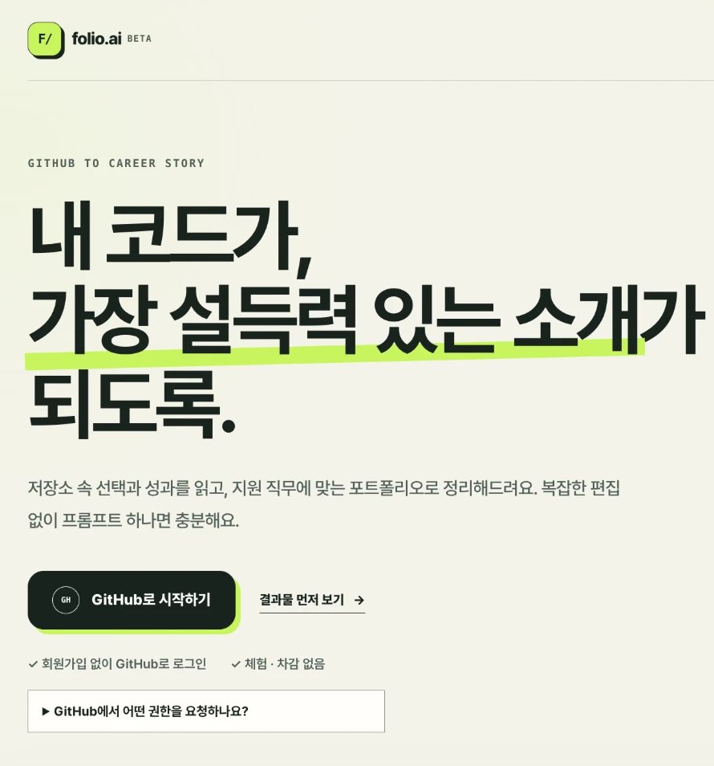
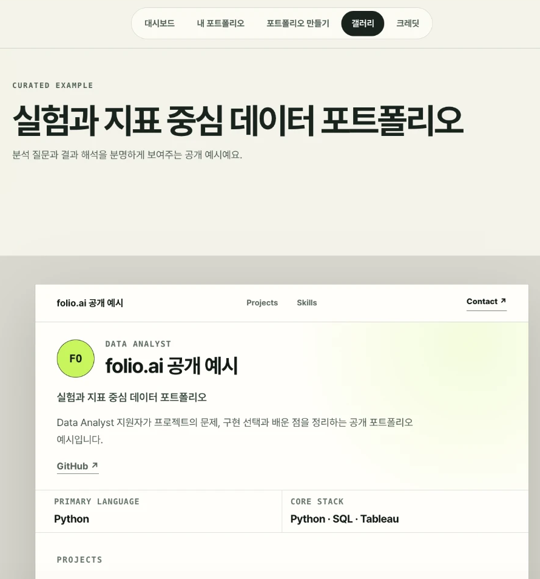
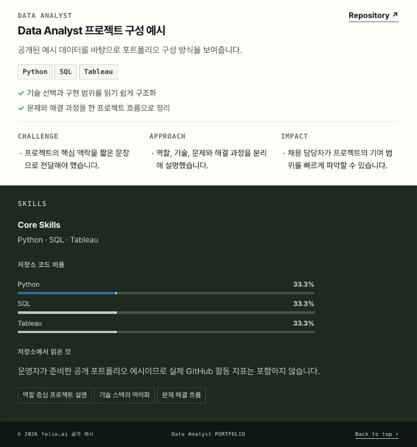

# 06. folio.ai - Codex Hackathon

> **소속** Codex Hackathon · 12팀 
> **역할** 프론트엔드 
> **기간** 2026.08.16 · 하루 해커톤

**Links** [코드](https://github.com/codex-hackathon-12/team12) · [시연 영상](https://youtu.be/08R_W-f0S8Q) · [서비스](https://folio.klr.kr)

 

## Overview

GitHub 저장소의 코드와 활동 기록을 분석해 취업용 개발자 포트폴리오와 이력서 초안을 만드는 AI 서비스입니다. GitHub로 로그인해 저장소와 강조할 경험을 고르면, 생성 과정을 거쳐 포트폴리오 웹페이지를 받습니다.

## Problem

- 개발자는 저장소에 작업 기록이 있어도 이를 포트폴리오 문장으로 옮기는 데 시간이 많이 듭니다.
- 해커톤 시간 안에 로그인부터 결과 페이지까지 한 흐름을 완성해야 했습니다.

## Architecture

```mermaid
%%{init: {'theme':'base','themeVariables':{'fontFamily':'Pretendard, Inter, sans-serif','fontSize':'14px','primaryColor':'#FFFFFF','primaryTextColor':'#282B30','primaryBorderColor':'#595D64','lineColor':'#595D64','clusterBkg':'#F7F7F5','clusterBorder':'#D9DCE0','edgeLabelBackground':'#FFFFFF','titleColor':'#282B30'}}}%%
flowchart LR
    L["랜딩<br/>정적 맛보기 · 갤러리"]:::mine
    G["GitHub OAuth<br/>로그인"]
    DB["대시보드<br/>최근 작업 · 크레딧"]:::mine
    RS["저장소 선택<br/>검색 · 필터 · 다중 선택"]:::mine
    PR["프롬프트 입력<br/>직무 · 강조 경험"]:::mine
    W["Vercel Workflow<br/>저장소 분석 · AI 생성"]
    PS["생성 상태<br/>polling · 재시도"]:::mine
    RE["포트폴리오 결과<br/>케이스 스터디 · PDF"]:::out
    L --> G --> DB --> RS --> PR --> W --> PS --> RE
    classDef default fill:#FFFFFF,stroke:#595D64,color:#282B30
    classDef mine fill:#192334,stroke:#192334,color:#FFFFFF
    classDef data fill:#F7F7F5,stroke:#D9DCE0,color:#282B30
    classDef out fill:#FFFFFF,stroke:#282B30,stroke-width:2px,color:#282B30
```

## Screens

<table>
<tr><th width="33%">랜딩</th><th width="33%">포트폴리오 예시 (갤러리)</th><th width="33%">생성된 프로젝트 · 역량 섹션</th></tr>
<tr><td valign="top"></td><td valign="top"></td><td valign="top"></td></tr>
</table>

랜딩에서 GitHub로 로그인하면 저장소를 골라 포트폴리오를 만들고, 결과는 A4 · 읽기 보기로 확인하거나 PDF로 저장할 수 있습니다.

## My Contribution

- Next.js 초기 설정과 팀 협업 기준 · API 계약 정리
- 포트폴리오 MVP 화면 — 랜딩, 저장소 선택, 프롬프트 입력, 생성 상태, 결과 페이지
- 포트폴리오 생성 흐름 UX 개선과 결과 포트폴리오 디자인 확장
- REST API 연결 안정성 보강
- 타이포그래피 가독성 개선

## Result

- 해커톤 기간 안에 GitHub 로그인 → 저장소 선택 → 생성 → 결과 · PDF 다운로드까지 동작하는 MVP 완성

 

[← 포트폴리오로 돌아가기](../README.md)
