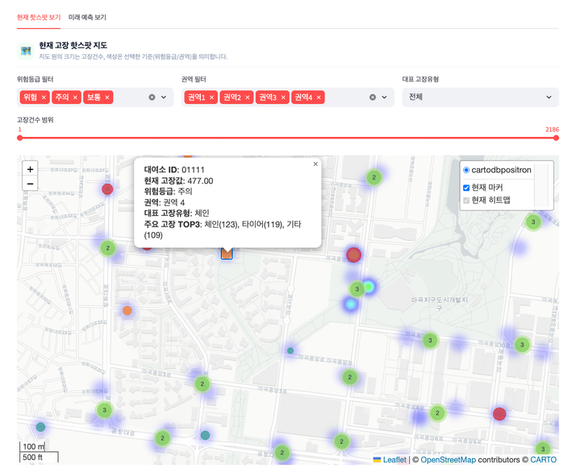
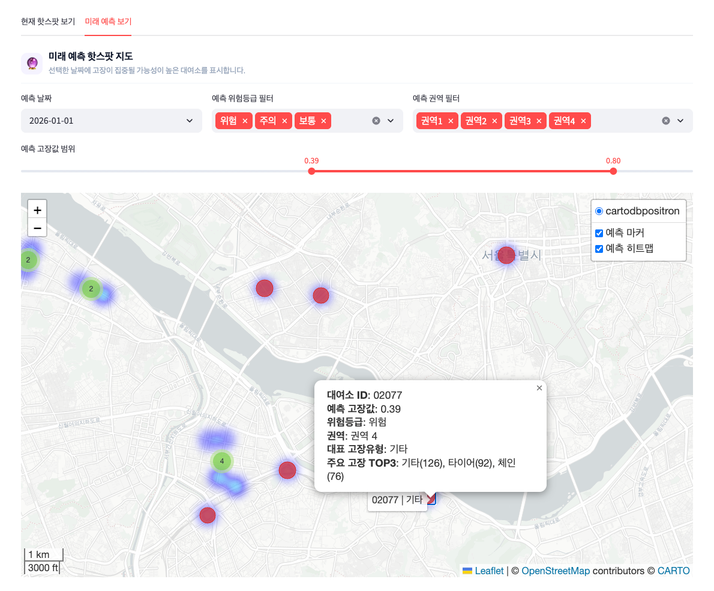

# 07. 서울시 따릉이 고장 주기 예측 및 원인 분석

> **소속** BITAmin 26-1 시계열 프로젝트 · 팀 3명 · 2026 서울시 빅데이터 활용 경진대회 출품 
> **역할** 고장 핫스팟 분석 · 대여소 고장 예측 · 대시보드 통합 
> **기간** 2026.03 – 05

**Links** [코드](https://github.com/Jinx921/26-1_BITAmin_project) · [대시보드](https://ts-project-dashboard.streamlit.app/)

 

## Overview

따릉이 고장 신고 · 대여 이력 · 대여소 위치 · 날씨 데이터로 **고장 가능성이 높은 자전거 · 부품 · 지역을 예측**하고, 정비 담당자가 쓸 수 있는 통합 대시보드로 만든 프로젝트입니다. 사후 대응 중심의 정비를 사전 예방 중심으로 바꾸는 것이 목표였습니다. EDA를 함께 진행한 뒤 세 갈래로 나눠 작업했고, 저는 **고장 전염 패턴 · 핫스팟 분석**과 **Streamlit 대시보드 통합 · 전체 디자인**을 맡았습니다.

## Problem

- **사후 대응** 고장 신고가 들어온 뒤에야 정비하는 구조라 이용 불편과 안전 문제가 생깁니다.
- **위치 정보 없음** 고장 신고 데이터에는 고장이 난 대여소가 없어, 지도로 볼 수 없었습니다.
- **규모** 대여 이력이 월별 파일로 나뉜 대용량 데이터라 그대로 병합하면 메모리가 부족했습니다.

## Approach

1. **전처리** 월별 대여 이력 · 고장 신고 · 대여소 위치 데이터를 정제(자전거번호 · 대여소 ID 형식 통일, 이상 좌표 · 중복 제거)해 parquet로 합쳤습니다. 대여소 위경도는 추가로 수집했습니다.
2. **고장 위치 추정** DuckDB로 불러와 메모리를 줄이고, **ASOF JOIN**으로 같은 자전거의 고장 등록 시점 직전 반납 대여소를 찾아 고장 발생 위치로 추정했습니다.
3. **핫스팟 군집** 좌표가 있는 대여소 2,790개를 위도 · 경도 · log(1+고장 건수)로 표준화해 군집화했습니다. DBSCAN(eps 0.5, 군집 3, noise 2.9%)과 K-Means(k = 3~8)를 비교해 실루엣 점수가 높은 K-Means(k=4)를 택했습니다.
4. **30일 예측** 대여소별 일별 고장 568,667건(1,794일)에서 최근 60일을 검증 구간으로 두고 Prophet과 lag · rolling 피처 XGBoost(재귀 예측)를 비교한 뒤, 더 나은 모델로 향후 30일을 예측해 대여소별로 나눴습니다.
5. **대시보드 통합** 세 사람의 분석을 하나의 Streamlit 앱(핫스팟 + 예측 지도 · 정비 우선순위 · 날씨 기반 예측)으로 연결하고, 페이지별 디자인을 다듬어 배포했습니다.

## Dashboard

| 현재 고장 핫스팟 | 30일 예측 핫스팟 |
|---|---|
|  |  |

위험 등급 · 권역 · 고장 건수로 걸러 보고, 대여소를 누르면 대표 고장 유형과 상위 3개 고장을 확인할 수 있습니다.

## My Contribution

- 공동 EDA (이용 · 고장 · 날씨 데이터)
- 대여소 위치 데이터 추가 수집, 대용량 데이터 전처리 · 병합 (DuckDB · parquet)
- ASOF JOIN 기반 고장 위치 추정과 대여소 단위 집계
- 핫스팟 군집 모델 비교 · 선택, 대여소별 30일 고장 예측
- 현재 핫스팟 / 미래 예측 지도 페이지 (위험 등급 · 권역 · 고장 건수 필터, Top 20 대여소, 고장 유형 분포)
- **Streamlit 전체 UI 연결 · 통합 디자인**, 배포 오류 · 메모리 문제 해결

## Result

| 비교 | 결과 |
|---|---|
| 핫스팟 군집 | K-Means 실루엣 0.340 > DBSCAN 0.214 |
| 30일 예측 (검증 60일) | Prophet MAE 146.81 · RMSE 165.18 → **XGBoost MAE 74.00 · RMSE 94.53** |

- XGBoost가 Prophet보다 MAE를 약 50% 줄여 최종 예측 모델로 썼습니다.
- 현재 핫스팟과 미래 위험 지역을 분리해 보여 주는 통합 대시보드를 배포했습니다.
- 2026 서울시 빅데이터 활용 경진대회에 출품했습니다.

### 한계와 다음 단계

- **한계** 신고된 고장만 반영되고, 실제 고장 위치 대신 직전 반납 대여소로 추정했습니다. 부품 교체 · 정비 완료 이력은 반영하지 못했습니다.
- **다음 단계** 실시간 대여 · 반납 데이터와 정비 이력을 연동하고, 예측과 실제 정비 결과를 비교해 모델을 재학습합니다.

 

[← 포트폴리오로 돌아가기](../README.md)
