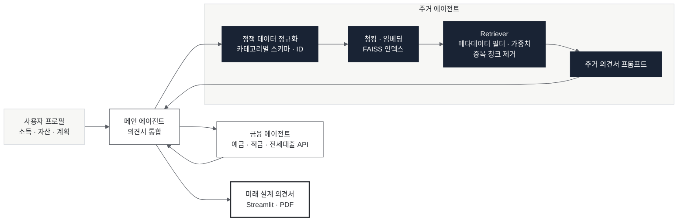

# 08. 청년 미래 설계 멀티 에이전트

> **소속** BITAmin NLP 프로젝트 · 팀 4명 
> **역할** 데이터 수집 · 주거 에이전트 개발 
> **기간** 2026.01 – 02

**Links** [코드](https://github.com/26-1-BITAmin-NLP/NLP) · [시연 영상](https://www.youtube.com/watch?v=hWKmdOxUxys)

 

## Overview

사용자의 소득 · 자산 · 계획을 분석해, 맞는 주거 정책과 금융 상품을 엮은 미래 설계 의견서를 만드는 멀티 에이전트 시스템입니다. 메인 에이전트가 주거 에이전트와 금융 에이전트의 결과를 합쳐 의견서를 씁니다.

## Problem

- 청년 주거 정책은 기관마다 형식이 달라, 조건(소득 · 나이 · 지역)에 맞는 정책을 찾기 어렵습니다.
- 정책 문서를 그대로 검색하면 조건이 맞지 않는 정책이나 중복된 내용이 섞여 나옵니다.

## Approach (주거 에이전트)

1. **정규화** 기숙사 · 임대 · 지원금 등 카테고리별로 형식이 다른 정책 데이터를 하나의 스키마로 정리하고 정책 ID 생성 규칙을 정했습니다.
2. **청킹 · 임베딩** 정책 단위로 청킹하고 벡터 임베딩 후 FAISS 인덱스를 만들었습니다.
3. **검색** 메타데이터를 매핑해 사용자 조건으로 필터링하고, 필터 가중치와 중복 청크 제거를 더했습니다.
4. **의견서** 검색된 정책으로 주거 의견서를 쓰는 프롬프트를 작성하고, 성별 등 사용자 입력 변수를 추가했습니다.

## Architecture

## My Contribution

- 주거 정책 데이터 수집 · 정규화 · 청킹 · 임베딩
- FAISS retriever 구현과 메타데이터 필터링 · 중복 제거
- 주거 의견서 프롬프트, 메인 에이전트와의 병합

## Result

- 사용자 프로필 입력 → 주거 · 금융 결합 의견서(PDF)까지 동작하는 Streamlit 앱 완성

 

[← 포트폴리오로 돌아가기](../README.md)
