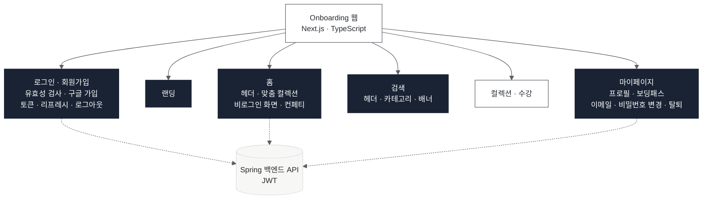
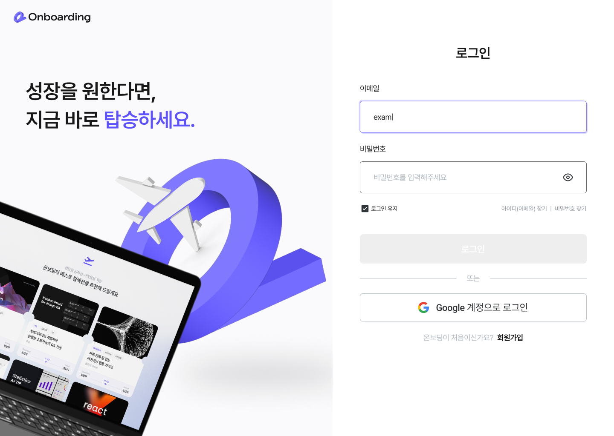
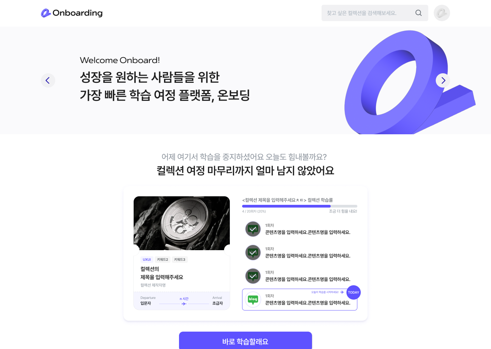
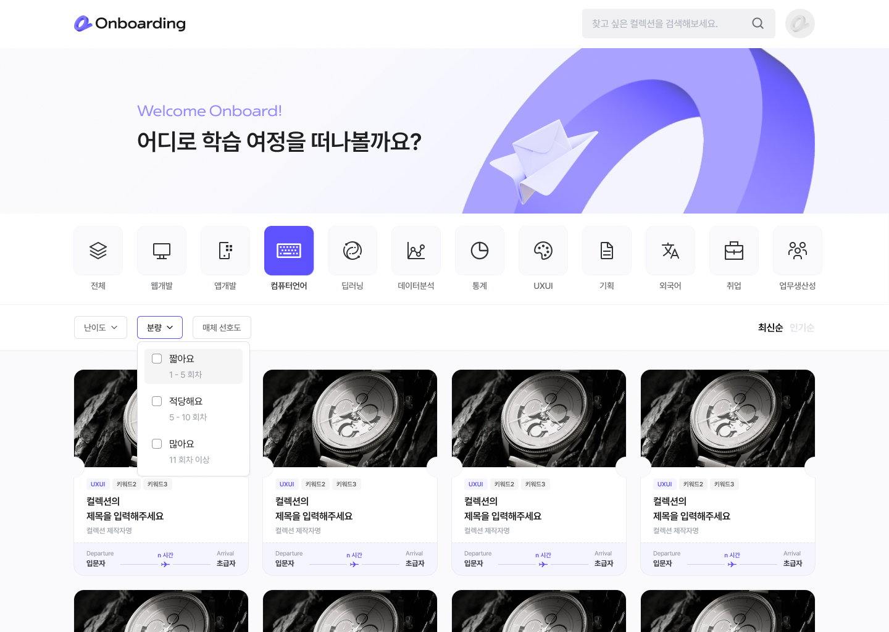
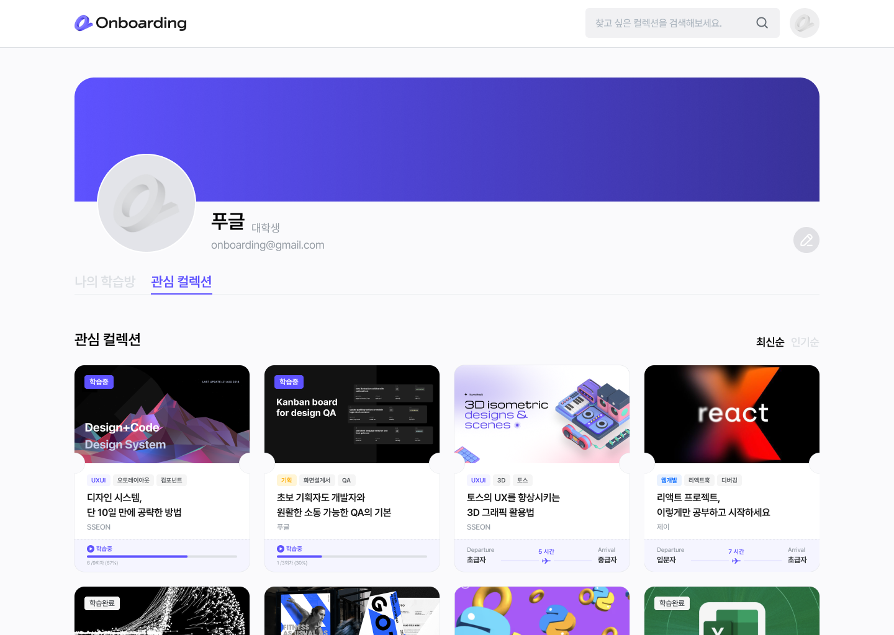

# 09. Onboarding - 학습 관리 서비스

> **소속** UMC 7기 · TeamLearningFlow · 프론트엔드 4명 
> **역할** 프론트엔드 
> **기간** 2024.12 – 2025.02

**Links** [프론트엔드 코드](https://github.com/TeamLearningFlow/Onboarding-FE) · [백엔드 코드](https://github.com/TeamLearningFlow/LearningFlow-BE)

 

## Overview

"학습의 출발이 쉬워지는 곳, 온보딩." 학습 목표를 정하고, 맞춤 컬렉션으로 강의를 이어 듣고, 완료한 학습을 보딩패스로 모으는 학습 관리 웹 서비스입니다. 프론트엔드는 Next.js와 TypeScript로 만들었고, 기능마다 GitHub 이슈를 만들어 Git Flow · PR 리뷰 규칙으로 협업했습니다.

| 핵심 수치 (프론트엔드 저장소) | |
|---|---|
| 커밋 | 139개 / 전체 약 237개 (팀 내 최다) |
| 이슈 | 22개 작성 · 전부 완료 / 전체 71개 |

## Architecture

## Screens

<table>
<tr><th width="50%">로그인</th><th width="50%">홈</th></tr>
<tr><td valign="top"></td><td valign="top"></td></tr>
<tr><th>검색</th><th>마이페이지</th></tr>
<tr><td valign="top"></td><td valign="top"></td></tr>
</table>

디자인 확정 화면 기준이며, 네 화면 모두 프론트엔드 구현과 API 연결을 맡았습니다.

## My Contribution

이슈 기준으로 맡은 영역입니다.

| 영역 | 작업 |
|---|---|
| **로그인 · 회원가입** | 페이지 컴포넌트 · UI 제작과 통일, 비밀번호 유효성 검사, 이메일 인증 · 로컬(이메일) 회원가입 · 로그인 API 연결, 구글 회원가입, 토큰 · 리프레시 토큰 처리, 로그아웃 API 연결 |
| **랜딩 · 홈** | 랜딩 페이지(닉네임 · 관심분야 · 선호도 입력, 이미지 업로드 API 연결), 홈 헤더, 맞춤 컬렉션 컴포넌트, 비로그인 화면, 모달 컨페티 효과, 스켈레톤 UI |
| **검색** | 검색 페이지 헤더 · 카테고리 상단, 카테고리 아이콘, 배너 |
| **마이페이지** | 프로필 UI, 완료 컬렉션 보딩패스 UI, 프로필 조회 · 수정 · 이미지 변경 API 연결, 이어서 학습하기 · 완료 · 좋아요 컬렉션 API 연결, 이메일 · 비밀번호 변경 · 계정 탈퇴 모달과 API 연결 |
| **공통** | 컬렉션 페이지 헤더 컴포넌트, 전체 페이지 반응형(태블릿) 작업 |

- 이메일 변경은 인증 메일의 토큰 검증 → 유저 정보 갱신 → 페이지 반영까지 흐름 전체를 맡아, 토큰 저장 · 만료 오류를 수정했습니다.
- Figma의 화면설계서 · 플로우차트 · 확정 UI를 기준으로 디자이너와 맞춰 구현했습니다.

## Result

- UMC 7기 데모데이에서 서비스 시연 (부스 운영)
- 서비스 인스타그램 계정 개설 · 운영
- UMC 7기 챌린저 수료 (Web 파트, 2024.09 – 2025.02)

 

[← 포트폴리오로 돌아가기](../README.md)
