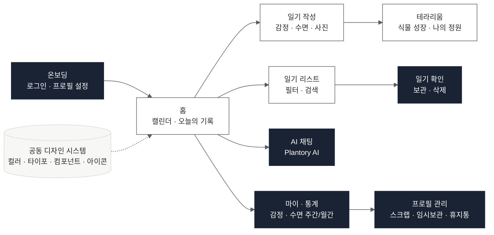
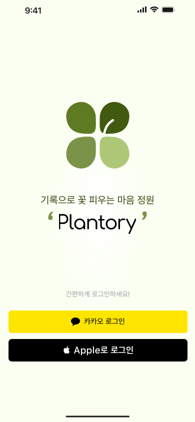
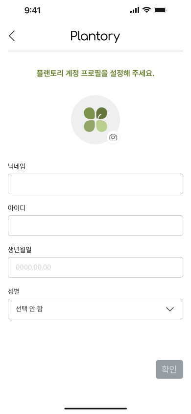
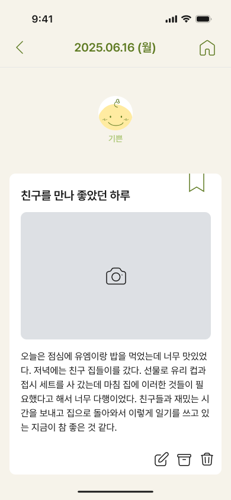
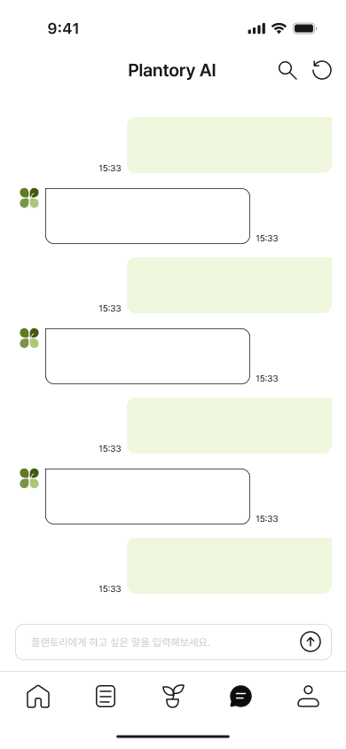
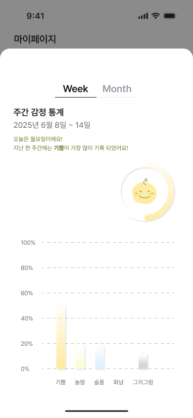

# 10. 플랜토리 - 성장형 일기 앱

> **소속** UMC 8기 · 디자이너 2명 
> **역할** 프로덕트 디자인 
> **기간** 2025.05 – 2026.01 · App Store 출시

**Links** [App Store](https://apps.apple.com/kr/app/%ED%94%8C%EB%9E%9C%ED%86%A0%EB%A6%AC-plantory/id6757394785) · [iOS 코드](https://github.com/UMC-Plantory/iOS) · [백엔드 코드](https://github.com/UMC-Plantory/Spring)

 

## Overview

"기록으로 꽃 피우는 마음 정원." 일기를 쓸수록 식물이 자라 테라리움을 채우는 방식으로 꾸준한 기록 동기를 주고, 감정 기록과 AI 챗봇으로 스스로를 돌아보게 하는 iOS 앱입니다. 디자이너 2명이 화면을 나눠 맡고, 디자인 시스템 · 아이콘 · 컴포넌트는 함께 만들었습니다. 2026년 1월 App Store에 출시했습니다.

## Problem

감정을 기록하려는 수요는 많지만, 기존 마음 기록 앱은 사용자 여정이 번거롭고 오래 쓰게 만드는 장치가 부족했습니다.

| Pain Point | 내용 | 디자인 방향 |
|---|---|---|
| **지속성** | 참여를 이끄는 디자인 · 동기 부여가 부족해 작심삼일로 끝남 | 기록할수록 식물이 자라는 시각적 보상, 부드러운 리마인더 |
| **표현의 부담** | 민감한 감정을 글로 적는 데 대한 심리적 저항 | 이모티콘 선택 등 최소 입력으로 기록, 말로 털어놓는 AI 챗봇 |
| **기록의 가치** | 기록이 나에게 어떤 의미인지 알 수 없음 (회고 · 통계 · 피드백 부재) | 주간 · 월간 감정 리포트와 통계, 패턴 기반 AI 코멘트 |

**Purpose** 감정을 기록하고 시각화해 자기 이해와 정서적 성장을 돕습니다.

**Target** 감정 기복 · 스트레스를 기록으로 다스리고 싶은 사람, 기록 습관으로 자기관리를 하고 싶은 사람.

## Process

1. **기획 이해** PM이 작성한 IA · 경쟁사 분석 · 화면 흐름을 바탕으로 와이어프레임을 만들었습니다.
2. **단계별 디자인 과제** 0~3차 과제(UI · 프로토타입 → 랜딩페이지 · 굿즈)로 UI를 다듬고 확정 화면을 모았습니다.
3. **iOS 가이드 분석** iOS 화면 패턴을 분석해 개발 구현과 맞췄습니다.
4. **프로토타입** 페이지 전환과 컴포넌트 상태 변화를 확인할 수 있는 인터랙티브 프로토타입을 만들었습니다.

## Information Architecture

## Screens

<table>
<tr><th width="20%">온보딩</th><th width="20%">프로필 설정</th><th width="20%">일기 확인</th><th width="20%">AI 채팅</th><th width="20%">감정 통계</th></tr>
<tr><td valign="top"></td><td valign="top"></td><td valign="top"></td><td valign="top"></td><td valign="top"></td></tr>
</table>

담당한 화면을 디자인 확정본 기준으로 모았습니다.

## My Contribution

| 구분 | 작업 |
|---|---|
| **담당 화면** | 온보딩, 일기 확인, AI 채팅, 마이 · 통계, 프로필 관리 |
| **공동 작업** | 식물 아이콘, 디자인 시스템(컬러 · 타이포 · 레이아웃 · 간격), 컴포넌트, 아이콘 |
| **브랜드 · 마케팅 (공동)** | 로고 · 앱 아이콘 · 캐릭터, 랜딩페이지, 굿즈, 배너 · 포스터, 앱스토어 이미지 |

## Design System

| 영역 | 내용 |
|---|---|
| 브랜드 | 네잎 형태 심볼 로고, 워드마크, 로고 가이드라인, 앱 아이콘 |
| 컬러 | Primary(그린) · Secondary · Background · Text 4개 팔레트 |
| 타이포그래피 | Heading · Body · Label 3단계 스케일 |
| 레이아웃 · 간격 | iOS 그리드와 spacing 규칙 |
| 컴포넌트 | 버튼 · 입력 · 카드 · 탭 · 모달 · 리스트, 다크 모드 |
| 아이콘 · 캐릭터 | 아이콘 세트, 식물 성장 단계, 감정별 캐릭터 |

## Result

- **App Store 출시** (2026.01)
- UMC 8기 데모데이에서 서비스 시연 (부스 운영)
- UMC 8기 수료증, Web 파트장 활동으로 공로상 수상

 

[← 포트폴리오로 돌아가기](../README.md)
